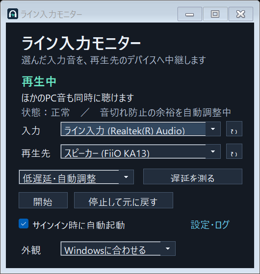

# Line Input Monitor

Windows向けのライン入力モニターです。入力音を選んだ再生デバイスへ中継し、ほかのPC音も同時に再生できます。

A Windows line-input monitor with shared audio output, a resident taskbar/tray app, adaptive buffering, and light/dark themes.



## インストール

[Releases](https://github.com/ryuya0124/line-input-low-latency/releases) の `LineInputLowLatency-Setup.exe` を実行してください。Windows 11 x64向けです。

- アプリ本体は `Program Files\LineInputLowLatency` にインストールします。
- ソースのスナップショットは `ドキュメント\LineInputLowLatency` に保存します。
- 設定とログは `%LOCALAPPDATA%\LineInputLowLatency` に保存します。
- サインイン時の自動起動を登録します。アプリのチェックで解除できます。
- バイナリは現在コード署名なしで配布しています。

## 使い方

1. タスクバーまたは通知領域からウィンドウを開きます。
2. ライン入力と再生先を選びます。初回は入力を選ぶまで音声を開始しません。
3. 「低遅延・自動調整」で再生します。必要に応じて「安定優先」を選べます。

再生先には「Windowsの既定の出力に従う」も選べます。Windows全体の既定出力は変更しません。外観はWindowsに追従するほか、ライト・ダークを指定できます。

×ボタンは最小化します。終了するには通知領域のメニューから「終了」を選んでください。「停止して元に戻す」は、記録してあるWindowsの「このデバイスを聴く」設定へ戻します。

## 音声処理

- 低遅延モードでは、48 kHz・16 bit・ステレオ対応の入力をWASAPI専用モードで使用します。
- 入力の保護バッファを短い間隔で読み出し、取り込み・再生・状態保存を別スレッドに分けます。
- 出力はWASAPI共有モードを維持するため、ほかのアプリの音も再生できます。
- データ不足を検出すると余裕を増やします。少しずつ余裕を減らす場合も、学習した下限を守ります。
- 音声をファイルへ録音する機能はありません。任意の簡易測定では一時的にメモリ内で音を比較します。

専用モードの入力は、他の録音アプリと同時に使えません。共有入力モードはステレオのfloatミックス形式に対応します。ドライバー、負荷、接続先によって達成できる遅延は変わり、特定のms値や完全な無音切れを保証するものではありません。

「遅延を測る」は入力と再生側の音の対応が十分に得られた場合だけ参考値を表示します。他のPC音の混入や信号の不足で測れないことがあります。音源機器や最終アナログ出力まで含めた総遅延の測定ではありません。

## アンインストール

Windowsの「インストールされているアプリ」、またはスタートメニューのアンインストーラーから削除できます。ソースコードは保持します。設定・ログも削除するか選べます。

## ビルド

Visual StudioのC++デスクトップ開発ツール、Windows SDK、.NET Framework 4.8、Node.jsを用意して、リポジトリで次を実行します。

```text
node build.mjs
```

Node.jsはC#のビルドツールを起動するためだけに使います。コンパイラーは直接exeとして呼び出し、Python・ps1・bat・cmdのスクリプトは使用しません。製品の実行にNode.jsは不要です。

インストーラーとソースZIPは `build/dist` に生成します。ビルドではパッケージの展開・削除、実行ファイル形式、禁止スクリプトの混入、ダーク・ライトの画面生成を検証します。CIで実機の音声遅延や音切れまで検証するものではありません。

## ライセンス

[MIT](LICENSE)。アイコンとビルドツールも含みます。外部の音量操作ツールには依存しません。
